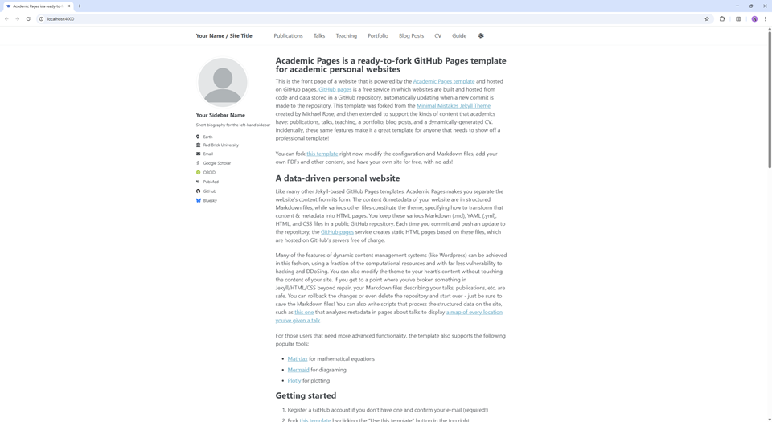

# 彭彦铭的个人学术主页

本站基于 Academic Pages，由 Jekyll 生成静态页面。站点配置地址为 https://pym666.github.io 。首页介绍北京交通大学的学习与研究经历，研究方向包括计算机视觉、噪声标签学习和视线估计。顶部导航目前有 Publications 和 Awards 两项。

## 内容维护入口

| 要更新的内容 | 文件 | 当前用途 |
| --- | --- | --- |
| 首页简介、研究兴趣、新闻 | `_pages/about.md` | 对应根路径 `/`，含 CVPR 2026 论文录用消息 |
| 侧栏身份与联系方式 | `_config.yml`、`images/profile.png` | 作者姓名、单位、头像、邮箱和学术主页链接 |
| 导航项目及顺序 | `_data/navigation.yml` | 控制页首菜单，页面是否生成还取决于页面与集合配置 |
| 论文与附件 | `_publications/2026-06-SeeTN.md`、`files/` | SeeTN 的摘要和会议元数据在 Markdown 中。Paper 指向 CVF，Poster 和 BibTeX 分别对应本地的 `SeeTN.pdf` 和 `SeeTN.bib` |
| 竞赛获奖 | `_pages/awards.html` | 页面直接列出 2023 年 CCPC 哈尔滨站金奖、ICPC 西安站和济南站银奖。`_awards/` 当前为空 |

## 页面如何生成

- **论文**：每篇论文在 `_publications/` 中独立维护。`_pages/publications.html` 按配置的类别汇总，调用 `_includes/publication-single.html` 输出标题、年份、简介和资源链接。新增论文时沿用现有条目结构，并核对分类和附件路径。
- **页面外观**：`_layouts/` 定义页面布局，`_includes/` 提供导航、作者侧栏和论文条目等组件。`assets/css/main.scss` 是主样式入口，样式模块与主题位于 `_sass/`。`images/` 同时保存站点图片和上游主题截图。
- **模板内容**：`_pages/cv.md` 和 `_data/cv.json` 仍是示例简历。`_teaching/`、`_talks/`、`_portfolio/` 保留示例条目，对应集合在配置中已注释。`_posts/` 保留示例博文，其中一篇日期为 2199 年，当前配置启用了 `future: true`。
- **辅助工具**：`markdown_generator/` 提供论文和报告的批量转换脚本与输入示例，`scripts/` 用于转换简历数据，`talkmap.py`、同名笔记本及 `talkmap/` 用于报告地点地图。

## 源码中待核对的内容

1. SeeTN 条目的 `citation` 仍引用模板示例论文，与 `files/SeeTN.bib` 的作者、题名及年份不一致。
2. 获奖页的 YAML 头部中，分组的 `title` 和 `note` 与页面字段同级。`title` 因此出现两次，模板读取的 `section.title` 与 `section.note` 均缺少对应值。
3. 简历、博客归档等页面虽未列入导航，仍有独立页面入口。核对访客可见内容时应一并检查这些路径。

## 本地预览

在仓库根目录运行 `bundle install` 和 `bundle exec jekyll serve`，再打开 `http://localhost:4000/`。使用 Docker 时可运行 `docker compose up --build`，端口同为 4000。

## 上游 Academic Pages 模板说明
**Academic Pages is a GitHub Pages template for personal and professional portfolio-oriented websites.**



# Getting Started

1. Register a GitHub account if you don't have one and confirm your e-mail (required!)
1. Click the "Use this template" button in the top right.
1. On the "New repository" page, enter your public repository name as "[your GitHub username].github.io", which will also be your website's URL.
1. Edit site-wide configuration in `_config.yml` and double check that the `url` is the one that you just selected in the previous step and that `repository` reflects the correct path for your repository.
1. Add your site content, upload any files (like PDFs, .zip files, etc.) to the `files/` directory. They will appear at https://[your GitHub username].github.io/files/example.pdf.
1. Check status by going to the repository settings, in the "GitHub pages" section
1. (Optional) Use the Jupyter notebooks or python scripts in the `markdown_generator` folder to generate markdown files for publications and talks from a TSV file.

See more info at https://academicpages.github.io/

### Additional Tutorials

Additional tutorials for working with the Academic Pages template can be found at the following sites:
- https://jayrobwilliams.com/posts/2020/06/academic-website/

## Running locally

When you are initially working on your website, it is very useful to be able to preview the changes locally before pushing them to GitHub. To work locally you will need to:

1. Clone the repository and made updates as detailed above.

### Using a different IDE
1. Make sure you have ruby-dev, bundler, and nodejs installed
    
    On most Linux distributions and [Windows Subsystem Linux](https://learn.microsoft.com/en-us/windows/wsl/about) the command is:
    ```bash
    sudo apt install ruby-dev ruby-bundler nodejs
    ```
    If you see error `Unable to locate package ruby-bundler`, `Unable to locate package nodejs `, run the following:
    ```bash
    sudo apt update && sudo apt upgrade -y
    ```
    then try running `sudo apt install ruby-dev ruby-bundler nodejs` again.

    On MacOS the commands are:
    ```bash
    brew install ruby
    brew install node
    gem install bundler
    ```
1. Run `bundle install` to install ruby dependencies. If you get errors, delete Gemfile.lock and try again.

    If you see file permission error like `Fetching bundler-2.6.3.gem ERROR:  While executing gem (Gem::FilePermissionError) You don't have write permissions for the /var/lib/gems/3.2.0 directory.` or `Bundler::PermissionError: There was an error while trying to write to /usr/local/bin.`
    Install Gems Locally (Recommended):
    ```bash
    bundle config set --local path 'vendor/bundle'
    ```
    then try run `bundle install` again. If succeeded, you should see a folder called `vendor` and `.bundle`.

1. Run `jekyll serve -l -H localhost` to generate the HTML and serve it from `localhost:4000` the local server will automatically rebuild and refresh the pages on change to Markdown (*.md) and HTML files, while changes to the core template and configuration (i.e., `_config.yml`) will require stopping and restarting Jekyll.
    You may also try `bundle exec jekyll serve -l -H localhost` to ensure jekyll to use specific dependencies on your own local machine.

If you are running on Linux it may be necessary to install some additional dependencies prior to being able to run locally: `sudo apt install build-essential gcc make`

## Using Docker

Working from a different OS, or just want to avoid installing dependencies? You can use the provided `Dockerfile` to build a container that will run the site for you if you have [Docker](https://www.docker.com/) installed.

You can build and execute the container by running the following command in the repository:

```bash
chmod -R 777 .
docker compose up
```

You should now be able to access the website from `localhost:4000`.

### Using the DevContainer in VS Code

If you are using [Visual Studio Code](https://code.visualstudio.com/) you can use the [Dev Container](https://code.visualstudio.com/docs/devcontainers/containers) that comes with this Repository. Normally VS Code detects that a development container configuration is available and asks you if you want to use the container. If this doesn't happen you can manually start the container by **F1->DevContainer: Reopen in Container**. This restarts your VS Code in the container and automatically hosts your academic page locally on http://localhost:4000. All changes will be updated live to that page after a few seconds.

# Maintenance

Bug reports and feature requests to the template should be [submitted via GitHub](https://github.com/academicpages/academicpages.github.io/issues/new/choose). For questions concerning how to style the template, please feel free to start a [new discussion on GitHub](https://github.com/academicpages/academicpages.github.io/discussions).

This repository was forked (then detached) by [Stuart Geiger](https://github.com/staeiou) from the [Minimal Mistakes Jekyll Theme](https://mmistakes.github.io/minimal-mistakes/), which is © 2016 Michael Rose and released under the MIT License (see LICENSE.md). It is currently being maintained by [Robert Zupko](https://github.com/rjzupkoii), and additional maintainers would be welcome.

## Bugfixes and enhancements

If you have bugfixes and enhancements that you would like to submit as a pull request, you will need to [fork](https://docs.github.com/en/pull-requests/collaborating-with-pull-requests/working-with-forks/fork-a-repo) this repository as opposed to using it as a template. This will also allow you to [synchronize your copy](https://docs.github.com/en/pull-requests/collaborating-with-pull-requests/working-with-forks/syncing-a-fork) of the template to your fork as well.

Unfortunately, one logistical issue with a template theme like Academic Pages that makes it a little tricky to get bug fixes and updates to the core theme. If you use this template and customize it, you will probably get merge conflicts if you attempt to synchronize, although [rebasing](https://git-scm.com/docs/git-rebase) the changes from this template will work along with manually [cherry picking](https://git-scm.com/docs/git-cherry-pick) the relevant commits. If you are not comfortable with the Git command line, you can save your various `.yml` configuration files and Markdown files, delete the repository, and fork it again. 

---
<div align="center">
    

[](https://github.com/academicpages/academicpages.github.io/graphs/contributors)
[](https://github.com/academicpages/academicpages.github.io/releases/latest)
[](https://github.com/academicpages/academicpages.github.io/blob/master/LICENSE)

[](https://github.com/academicpages/academicpages.github.io)
[](https://github.com/academicpages/academicpages.github.io/fork)
</div>
